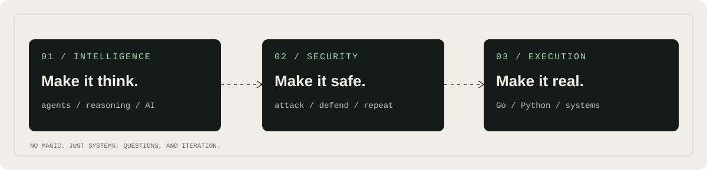

<div align="center">



<br />

**A curious mind with a compiler, a threat model, and too many browser tabs.**

[the things I build](https://wewer.io) &nbsp;·&nbsp; [the things I think](https://www.linkedin.com/in/ravalshrey/) &nbsp;·&nbsp; [the code](https://github.com/Coffeedragon96?tab=repositories)

</div>

<br />



### `~/about`

I live where **AI meets cybersecurity** — building autonomous systems, questioning their assumptions, and designing the architecture that keeps them useful, resilient, and difficult to break.

I started with code. Then came research, teaching, security, and eventually the irresistible urge to build my own things.

Now I run **[Wewer](https://wewer.io)**, where I turn interesting problems into software. Sometimes products. Sometimes experiments. Usually both.

### `~/currently`

```text
> building       agentic AI & products with actual utility
> thinking       who watches the agents?
> engineering    Go · Python · distributed systems · cloud
> breaking       assumptions, prototypes, occasionally my own code
> learning       everything that makes the above obsolete
```

### `~/rules-of-thumb`

- If it needs a 40-slide deck to explain, it probably needs another design pass.
- AI without guardrails is just confidence at scale.
- Security is an architectural decision, not a final checklist.
- I like boring infrastructure and ambitious ideas.
- Ship, observe, rethink, repeat.

<details>
<summary><b>One academic side quest ↗</b></summary>

<br />

I used to spend a fair bit of time in classrooms and research labs. Teaching technical ideas taught me to distrust explanations that only sound clever.

I also co-authored a paper on [adaptive live task migration in cloud environments](https://link.springer.com/chapter/10.1007/978-981-13-1742-2_64). Turns out I've been thinking about resilient systems for a while.

</details>

---

<div align="center">

*Build thoughtfully. Break responsibly. Stay curious.*

<sub>Based in Canada · Usually somewhere between an idea and a working prototype.</sub>

</div>
