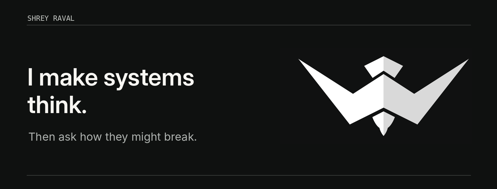

<p align="center">
  
</p>

<p align="center">
  <a href="https://wewer.io">what I build</a> &nbsp; / &nbsp;
  <a href="https://www.linkedin.com/in/ravalshrey/">what I think</a> &nbsp; / &nbsp;
  <a href="https://github.com/Coffeedragon96?tab=repositories">what I ship</a>
</p>

<br />

### `whoami`

I work at the intersection of **AI, security, and the things that hold software together**.

Some days I build agents. Some days I ask them uncomfortable questions. Most days I'm figuring out how to make powerful systems useful *without making them fragile*.

Founder & builder at **[Wewer](https://wewer.io)**. Previously found in research labs, classrooms, and a few too many terminals.

### `current_processes`

```text
[ running ]  building practical agentic systems
[ running ]  designing secure platforms
[ running ]  Go + Python + whatever the problem calls for
[ forever ]  wondering how it breaks
```

### `design_constraints`

> **Think boldly. Design defensively. Ship deliberately.**

I like boring infrastructure, thoughtful abstractions, security by design, and products that do more than demo well. I am suspicious of unnecessary complexity — including the kind I occasionally introduce myself.

<details>
<summary><strong>the academic side quest</strong></summary>

<br />

I've taught software, automation, networking and security, and worked in applied research. A small artifact from that era: [Adaptive Live Task Migration in Cloud Environment for Significant Disaster Prevention and Cost Reduction](https://link.springer.com/chapter/10.1007/978-981-13-1742-2_64) (Springer).

</details>

---

<p align="center"><sub>Build thoughtfully · Break responsibly · Stay curious</sub></p>
